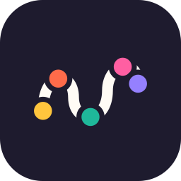
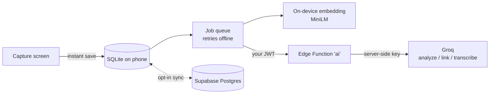

<div align="center">



# noodle

**What's on your noodle?**

Type a thought in two seconds. Noodle tags it, links it to your older thoughts, and lets you find it later by search or mind map.<br>
Works offline. Lives on your phone. Open source.

[](LICENSE)


[**Download the APK**](https://github.com/DhrubaDC1/noodle/releases/latest) · [How it works](#how-it-works) · [Run it yourself](#run-it-yourself) · [Self-host the AI](supabase/README.md)

</div>

<!--
Screenshots: drop PNGs in docs/screenshots/ and uncomment.

<p align="center">
  
  
  
  
</p>
-->

## Why noodle

Notes apps want you to file things. Your head doesn't work in folders. Noodle skips the filing:

- **Capture first.** The app opens to a text box. Saving is instant and never waits on the network, the AI or a login.
- **It files itself.** In the background an LLM gives each thought a title, a type (idea, project, to-do, memory, question), topics, and any time you mentioned.
- **It connects the dots.** "Budgeting app idea" finds the old note that only says "track my spending", and tells you *why* they are related.
- **Find it however you remember it.** Keyword search, search by meaning, topic bubbles, or a mind map centred on one thought.

## Features

| | |
| --- | --- |
| **Local-first, offline** | Everything lives in SQLite on your phone. No signal, no problem. AI work waits in a retrying queue and catches up later. |
| **AI tags and links** | Title, type, tags and reminder suggestions per thought. Related thoughts come with a one-line reason ("same project", "follow-up", "contradicts"). |
| **Search two ways** | SQLite FTS5 keyword search plus on-device embeddings (all-MiniLM-L6-v2) for "similar in meaning". |
| **Mind map** | Topic view (bubbles sized by count) or thought view (one thought and its links). Pan, zoom, tap to re-centre. |
| **Voice and share** | Speak a thought (Whisper). On Android, share text from any app straight into Noodle. |
| **Reminders** | The AI suggests "Remind me Fri 6 pm?" and one tap schedules it. Nothing is set without you. |
| **Private by design** | Signing in is optional. Sync is a separate opt-in switch. Sign out and your thoughts stay. No API key ever ships in the app. |
| **Dark mode, no clutter** | Follows your system. Sticker-style UI, one colour per thought type. |

## How it works



1. **Embed** on the phone: a 384-number vector per thought.
2. **Analyze** through the `ai` Edge Function: one call returns title, type, tags and an optional reminder.
3. **Link**: cosine similarity picks the 8 closest older thoughts, then the LLM confirms which are truly related and names the link. The whole history is never sent to the model.

The Groq key is a Supabase secret read only by the function. The app signs in with an email code and calls the function with your session. Each account is capped at 500 AI calls per day.

**Privacy, plainly:** with AI on (signed in), the text of a thought is sent to Groq to be tagged and linked. Signed out, nothing leaves your phone. Sync copies thoughts, tags and links to your Supabase account only if you switch it on; embeddings, audio and jobs never sync.

Full design and decisions: [docs/PLAN.md](docs/PLAN.md). Look and feel: [docs/DESIGN.md](docs/DESIGN.md).

## Install

**Android:** download the APK from [Releases](https://github.com/DhrubaDC1/noodle/releases/latest), open it, and allow installs from your browser if asked.

**iOS:** build it yourself for now (below). Sharing an IPA needs an Apple Developer account and registered devices.

## Run it yourself

Noodle needs a development build, not Expo Go, because on-device embeddings use native code.

```bash
git clone https://github.com/DhrubaDC1/noodle.git
cd noodle
npm install
cp .env.local.example .env.local   # add your Supabase URL and publishable key
npx expo run:android               # or: npx expo run:ios
```

Without `.env.local` the app still captures and does keyword search; the AI features need a Supabase project.

**Release APK on a low-RAM machine:**

```bash
cd android && ./gradlew assembleRelease -PreactNativeArchitectures=arm64-v8a --no-parallel --max-workers=2 --no-daemon
```

The APK lands in `android/app/build/outputs/apk/release/`.

### Self-host the AI

Create a free Supabase project, push the migrations, and set your own Groq key as a secret. Step by step: [supabase/README.md](supabase/README.md). Model IDs live in one file, `supabase/functions/ai/config.js`.

## Tech

Expo SDK 58 · expo-router · expo-sqlite (FTS5) · react-native-executorch · react-native-svg + d3-force · expo-audio · expo-notifications · Supabase (Auth, Postgres, Edge Functions) · Groq (`qwen/qwen3.8-27b`, `whisper-large-v3-turbo`). JavaScript only, no TypeScript.

## Checks

```bash
npm run selfcheck      # database layer, AI request checks, two-phone sync simulation
npm run test:function  # the ai Edge Function: validation, daily cap, errors
npm run sqlcheck       # Supabase migrations in Postgres (PGlite, no Docker)
```

Node 22+.

## Roadmap

- [ ] iOS share-from-other-apps
- [ ] Export a backup
- [ ] "Delete my cloud data" button
- [ ] Server-assigned versions for sync conflicts

## Contributing

Issues and pull requests are welcome. Read [docs/DESIGN.md](docs/DESIGN.md) first: when code and design disagree, the design wins.

## License

[MIT](LICENSE) © 2026 Dhruba Chakraborty
